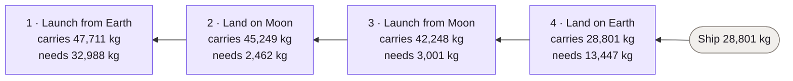
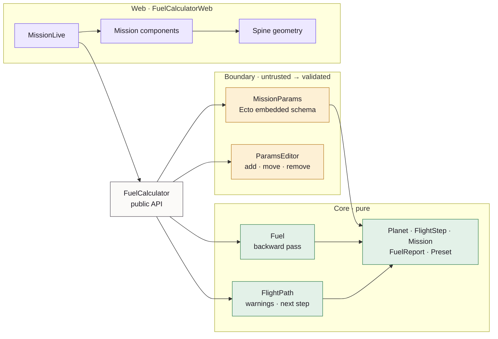
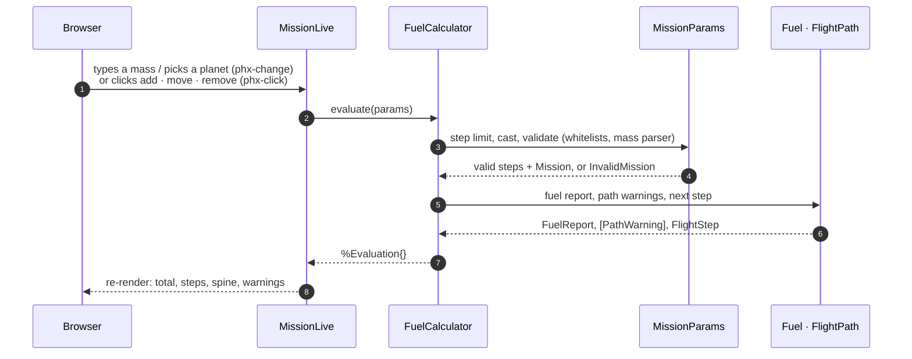

# Fuel Calculator

A Phoenix LiveView app that calculates the fuel a spacecraft needs to launch
from and land on Earth, the Moon and Mars. Enter the equipment mass, build a
flight path, and the total updates as you type, with every step's fuel, the
mass each burn has to move, and the "fuel needs fuel" chain on screen.

Built for the [Elixir full-stack challenge](docs/CHALLENGE.md).

## The one thing to get right

Fuel adds mass, so the fuel needs fuel of its own, and so on until the
formula gives zero. That much is in the spec. The less obvious part: **every
step also carries the fuel for all the steps after it**. The launch from
Earth lifts the fuel needed to land on the Moon, launch again and land back
home. So the calculation runs from the last step back to the first.

| Apollo 11, 28,801 kg | Per step, dry mass only | Last step first (correct) |
|---|---|---|
| Launch from Earth | 19,772 kg | carries 47,711 kg → **32,988 kg** |
| Land on the Moon | 1,535 kg | carries 45,249 kg → **2,462 kg** |
| Launch from the Moon | 2,024 kg | carries 42,248 kg → **3,001 kg** |
| Land on Earth | 13,447 kg | carries 28,801 kg → **13,447 kg** |
| **Total** | 36,778 kg ✗ | **51,898 kg** ✓ (matches the spec) |

All three spec missions (51,898, 33,388 and 212,161 kg) are acceptance tests
and one-click presets in the app.



The arithmetic is exact: gravity is stored in thousandths and the formula
uses integer floor division. Floating point is *not* good enough here: the
mass a burn carries can reach about 4×10¹³ kg, where floats round wrongly
(there's a regression test for it).

## Running it

Requirements: Erlang/OTP 29.1.2 and Elixir 1.20.4 (pinned in
`.tool-versions`; `mise install` or `asdf install` picks them up).

```sh
mix setup          # dependencies and assets
mix phx.server     # or: iex -S mix phx.server
```

Then open <http://localhost:4000>.

With [`just`](https://github.com/casey/just) installed, `just` lists the
shortcuts; every recipe is a plain `mix` command underneath.

| Task | `mix` | `just` |
|---|---|---|
| Install and build assets | `mix setup` | `just setup` |
| Dev server | `iex -S mix phx.server` | `just server` |
| Format | `mix format` | `just fmt` |
| Lint (format check, warnings as errors, Credo strict) | `mix lint` | `just lint` |
| Tests | `mix test` | `just test` |
| Tests with coverage | `mix test --cover` | `just cover` |
| Type check | `mix dialyzer` | `just dialyzer` |
| Security (Hex, advisories, Sobelow) | `mix audit` | `just audit` |
| Everything CI runs | | `just ci` |

## Architecture

Three layers with one public door. The web layer only calls the
`FuelCalculator` context and reads the structs it returns; input is
validated at the boundary; the core is pure and has no Phoenix or Ecto in it.



One edit, end to end:



| Module | Role |
|---|---|
| `FuelCalculator` | The public API: `evaluate/1`, `build_mission/1`, `fuel_report/1`, presets and the step-editing functions |
| `FuelCalculator.Fuel` | The formula and the backward pass, in exact integers |
| `FuelCalculator.FlightPath` | Path continuity warnings (with two fixes each) and the suggested next step |
| `FuelCalculator.MissionParams` | Raw form input → validated `Mission`; the only place strings become atoms (through `Ecto.Enum`) |
| `FuelCalculatorWeb.MissionLive` | The screen: keeps the form params, handles events, renders components |
| `FuelCalculatorWeb.Mission.*Components` | Small function components: spacecraft inputs, summary, flight path, spine, warnings, undo |

## Tests

About 140 tests: unit tests and doctests for the core (including the
zero-fuel threshold for every action and planet), acceptance tests for the
three spec missions, StreamData properties (fuel never negative, more mass
never needs less fuel, each step carries the fuel for later steps, agreement
with a naive reference), boundary tests for every validation message and
tampered input (no atoms are created from user input), and LiveView tests
that drive the real form and buttons.

## Documents

- [`docs/CHALLENGE.md`](docs/CHALLENGE.md): the original spec, verbatim.
- [`PRODUCT.md`](PRODUCT.md): how we read the spec and every product
  decision, with reasoning.
- [`DESIGN.md`](DESIGN.md): themes, tokens, measured contrast, layout,
  states, motion and accessibility.
- [`AGENTS.md`](AGENTS.md): engineering rules for anyone (or any agent)
  working on the code.
- [`docs/phoenix-guidelines.md`](docs/phoenix-guidelines.md): Phoenix 1.8 /
  LiveView usage rules generated by `phx.new`.

Dependencies follow a 7-day release cooldown; exceptions for security or
OTP 29 compatibility fixes are commented next to each dependency in
`mix.exs`.
