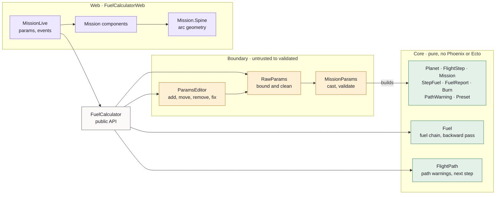
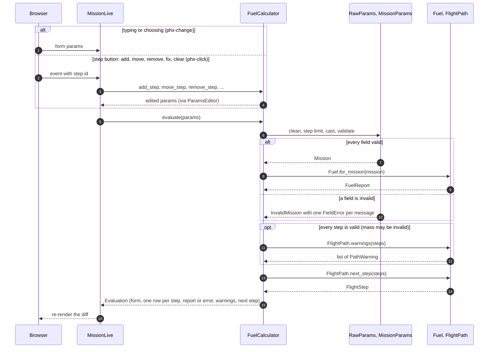

# Fuel Calculator

A Phoenix LiveView app that works out the fuel a spacecraft needs to launch
from and land on Earth, the Moon and Mars. Enter the equipment mass, build a
flight path, and the total updates as you type. Every step shows its fuel and
its mass at burn, and the selected step shows its fuel chain, so you can see
where the number comes from.

Built for the [Elixir full-stack challenge](docs/CHALLENGE.md). It matches all
three of the spec's missions to the kilogram.

## Features

- **Live total.** Fuel, wet mass (ship + fuel), mass ratio and route update
  on every edit. The mass field waits 250 ms after the last keystroke.
- **Spec missions as presets.** Apollo 11 opens by default; Mars mission and
  Passenger ship are one click away.
- **Flight path editing.** Add, remove and move steps up or down. "Add step"
  suggests the next logical step, e.g. "Launch from Moon" after "Land on Moon".
- **Path warnings that never block.** Launching from a planet the ship isn't
  on, launching while in flight, or landing while landed shows a warning with
  two fixes: add the missing steps before it, or change the step. The total
  is still calculated.
- **Where the number comes from.** Each step shows its fuel and its mass at
  burn ("ship + fuel for steps 3–4"). Select a step number to see its fuel
  chain. A step that needs no fuel shows the arithmetic
  (`⌊100 × 1.62 × 0.033⌋ − 42 = 5 − 42 = −37`).
- **Clear validation.** Mass is whole kilograms from 1 to 1,000,000,000
  (commas allowed, grouped as you type). Invalid input shows a message, and
  the total shows "—" instead of a stale number.
- **Undo** for removing a step, clearing the path or loading a preset over
  your edits.
- Light and dark themes, a phone layout down to 320px, keyboard and
  screen-reader support.

## Quick start

You need Erlang/OTP 29.1.2 and Elixir 1.20.4. Both are pinned in
`.tool-versions`, so `mise install` or `asdf install` picks them up. You also
need `git` (two asset dependencies come from GitHub). There is no database
and no Node.js: `mix setup` downloads Tailwind and esbuild.

```sh
mix setup          # fetch dependencies, download and build assets
mix phx.server     # or: iex -S mix phx.server
```

Open <http://localhost:4000>. Set `PORT` to use another port.

## Why it's interesting: every step carries the later fuel

Fuel adds mass, so fuel needs fuel of its own, and so on until the formula
gives zero or less. For the spec's example, landing 28,801 kg on Earth:

```text
28,801 kg → 9,278 → 2,960 → 915 → 254 → 40 → stop     13,447 kg
```

That is the **fuel chain**, and it's in the spec. The less obvious part:
**every step also carries the fuel for all the steps after it.** The launch
from Earth lifts the fuel needed to land on the Moon, launch again and land
back home. So the calculation runs from the last step back to the first, and
each step's **mass at burn** is the ship plus the fuel for every later step.

```mermaid
flowchart RL
    classDef step fill:#EDE8FF,stroke:#7354E8,color:#1F1B24
    classDef mass fill:#F1EFEC,stroke:#88817B,color:#1F1B24

    ship(["Ship<br/>28,801 kg"]):::mass
    s4["4 · Land on Earth<br/>mass at burn 28,801 kg<br/>needs 13,447 kg"]:::step
    s3["3 · Launch from Moon<br/>mass at burn 42,248 kg<br/>needs 3,001 kg"]:::step
    s2["2 · Land on Moon<br/>mass at burn 45,249 kg<br/>needs 2,462 kg"]:::step
    s1["1 · Launch from Earth<br/>mass at burn 47,711 kg<br/>needs 32,988 kg"]:::step
    wet(["Wet mass<br/>80,699 kg"]):::mass

    ship --> s4
    s4 -- "+ 13,447 kg" --> s3
    s3 -- "+ 3,001 kg" --> s2
    s2 -- "+ 2,462 kg" --> s1
    s1 -- "+ 32,988 kg" --> wet
```



Read left to right for flight order, right to left for calculation order.
Skipping the carried fuel gives the wrong answer:

| Apollo 11, 28,801 kg | Ship only (wrong) | With later fuel (correct) |
|---|---:|---:|
| 1 · Launch from Earth | 19,772 kg | **32,988 kg** |
| 2 · Land on the Moon | 1,535 kg | **2,462 kg** |
| 3 · Launch from the Moon | 2,024 kg | **3,001 kg** |
| 4 · Land on Earth | 13,447 kg | **13,447 kg** |
| **Total** | 36,778 kg | **51,898 kg**, as in the spec |

The other two spec missions (33,388 and 212,161 kg) match too. All three are
acceptance tests, the app's presets (built from the same data), and LiveView
tests that build them step by step through the UI.

**The arithmetic is exact.** Gravity is stored in thousandths (Earth 9807,
Moon 1620, Mars 3711) and the formula uses integer floor division. Floats are
not good enough: at the input limits (10⁹ kg, 20 launches from Earth) a single
burn carries about 2.4×10¹³ kg and the wet mass reaches 4.1×10¹³ kg, and at
that scale a float version can be off by 1 kg. A regression test pins one
such case (797,164,543 kg, 20 launches from Earth).

## How it works

Three layers with one public entry point. The web layer calls only the
`FuelCalculator` module and reads the structs it returns. Raw form input is
cleaned and validated at the boundary. The core (the calculation, path checks
and value structs) uses no Phoenix and no Ecto.



### One edit, end to end

Every change, typed or clicked, ends in `FuelCalculator.evaluate/1`, which
never fails. Validation errors and path warnings take different routes:
**an error removes the total, a warning keeps it.**



Loading a preset and undo also just set new params and call `evaluate/1`.

### Modules

| Module | Role |
|---|---|
| `FuelCalculator` | The public API: `evaluate/1`, `build_mission/1`, `fuel_report/1`, presets (`presets/0`, `preset_params/2`, `matches_preset?/2`), reference data (`planets/0`, `actions/0`, `formula_factors/0`, `burn_formula/2`) and the step edits (`add_step`, `remove_step`, `move_step`, `replace_step`, `insert_steps_before`, `clear_steps`) |
| `FuelCalculator.Evaluation` | Everything the screen needs for one input: form changeset, one `Row` per step (its step, fuel, warning and errors), fuel report or error, next step, step limit |
| `FuelCalculator.Fuel` | The formula, the fuel chain and the backward pass, in exact integers |
| `FuelCalculator.FlightPath` | Path warnings (two fixes each) and the suggested next step |
| `FuelCalculator.RawParams` | The one reader of browser params: keeps known keys, bounds lengths and counts, gives every step a unique id |
| `FuelCalculator.MissionParams` | Clean params → validated `Mission`. Planet and action strings become atoms here, through `Ecto.Enum`; the LiveView matches preset ids and directions against fixed lists and never creates atoms |
| `FuelCalculator.ParamsEditor` | Add, move, remove and fix steps in the params |
| `FuelCalculator.Preset` | The three spec missions, shared by the UI and the acceptance tests |
| `FuelCalculatorWeb.MissionLive` | The only page (`/`): keeps the form params, handles events, undo and focus, renders components |
| `FuelCalculatorWeb.Mission.Spine` | Geometry of the flight spine arcs beside the steps |

### The screen

| On screen | Component | Module (`FuelCalculatorWeb.Mission.`) |
|---|---|---|
| Mass input and "Start from" presets | `mass_field`, `preset_picker` | `SpacecraftComponents` |
| Total fuel, wet mass, mass ratio, route, steps | `summary_panel` | `SummaryComponents` |
| Total pinned to the bottom | `pinned_total` | `SummaryComponents` |
| Step rows, mass at burn, Add step | `flight_path` | `FlightPathComponents` |
| Spine arc, fuel bar, fuel chain | `spine_column`, `fuel_bar`, `fuel_chain` | `SpineComponents` |
| Path warning and its two fixes | `path_warning` | `PathWarningComponents` |
| Validation messages | `field_error` | `ErrorComponents` |
| Planet dots | `planet_dot` | `PlanetComponents` |
| Animated numbers | `rolling_number` | `NumberComponents` |
| Undo toast | `undo_toast` | `UndoComponents` |

### Project layout

```text
lib/
├── fuel_calculator.ex          public API, the only module the web layer calls
├── fuel_calculator/            domain: Fuel, FlightPath, RawParams, MissionParams,
│   │                           ParamsEditor, Evaluation and the value structs
│   └── error/                  InvalidMission, FieldError
└── fuel_calculator_web/
    ├── live/mission_live.ex    the page, its events and state (+ mission_live/undo.ex)
    ├── components/mission/     function components for the screen
    ├── mission/spine.ex        spine arc geometry
    └── format.ex               numbers, kg, ratio, formulas and step labels
test/
├── fuel_calculator/            core: unit, doctest, property and edge-case tests
├── fuel_calculator_test.exs    public API and input boundary
├── fuel_calculator_web/        LiveView, spine, format, fonts, security headers
└── support/builders.ex         mission(28_801, "launch earth, land moon")
```

## Tests

221 tests (199 examples, 7 StreamData properties, 15 doctests); the suite
runs in about 2 seconds.

| Layer | What is covered |
|---|---|
| Core | The spec's fuel chain; the zero-fuel threshold for every action and planet; the backward pass; the float regression case; the heaviest mission allowed |
| Acceptance | The three spec missions, from the presets and built step by step in the UI |
| Properties | Fuel is never negative and every chain link is smaller than the last; more mass never needs less fuel; each step carries the ship plus later fuel; adding a step never lowers the total; agreement with a naive float version for light missions; editing and evaluating malformed params never crash |
| Boundary | Every mass and step validation message; unusual ways of writing the mass; steps sent as lists or indexed maps; tampered, missing and duplicate values; the 20-step limit; no atoms created from user input |
| LiveView | The real form and buttons, selected by DOM id: presets, editing, warnings and fixes, fuel chain, zero-fuel arithmetic, undo and its timer, keyboard focus, screen-reader announcements, pinned total |
| Security | Content Security Policy headers, no inline scripts, self-hosted fonts |

## Development tasks

With [`just`](https://github.com/casey/just) installed, `just` lists the
shortcuts; each one runs the `mix` command next to it.

| Task | `mix` | `just` |
|---|---|---|
| Install and build assets | `mix setup` | `just setup` |
| Dev server with IEx | `iex -S mix phx.server` | `just server` |
| Format | `mix format` | `just fmt` |
| Lint: format check, warnings as errors, Credo strict | `mix lint` | `just lint` |
| Tests (optionally a path or flags) | `mix test` | `just test test/fuel_calculator` |
| Tests with coverage | `mix test --cover` | `just cover` |
| Type check (first run builds the PLT, a few minutes) | `mix dialyzer` | `just dialyzer` |
| Security: Hex, advisories, Sobelow | `mix audit` | `just audit` |
| Lint, tests, types and security (the CI checks) | | `just ci` |

CI ([`.github/workflows/ci.yml`](.github/workflows/ci.yml)) runs the same
checks on every push to `main` and every pull request, with the security
audit as a separate job.

## Key decisions

The reasoning for each is in [`PRODUCT.md`](PRODUCT.md).

- **Backward pass**, last step first, because each step carries the later
  fuel. It's the only reading that matches the spec's mission totals.
- **Zero or negative means no fuel**, for the first calculation of a step
  too, so a light ship can need no fuel for a step.
- **Whole kilograms, 1 to 1,000,000,000 kg; at most 20 steps.** Both bound
  untrusted input and the work per keystroke.
- **An empty flight path is valid.** It shows an empty state, not an error.
- **Path warnings never block the total.** The formula doesn't depend on
  continuity, and a single leg is a valid thing to model.
- **No database.** Forms use Ecto embedded schemas only (`ecto` without
  `ecto_sql`).
- **Stable Phoenix 1.8 and LiveView 1.2**, not the 1.8.0-rc the spec
  mentions.
- **Dependencies wait 7 days after release.** Security and OTP 29 fixes are
  exceptions, each commented next to the dependency in `mix.exs`.

## Troubleshooting

- **Port 4000 is taken:** `PORT=4001 mix phx.server`.
- **`mix dialyzer` is slow the first time:** it builds the PLT in
  `priv/plts`; later runs are fast.
- **Wrong Erlang or Elixir version:** run `mise install` (or `asdf install`)
  in the project directory, then `mix deps.get`.

## Documents

- [`docs/CHALLENGE.md`](docs/CHALLENGE.md): the original spec, verbatim.
- [`PRODUCT.md`](PRODUCT.md): how we read the spec and every product
  decision, with reasoning.
- [`DESIGN.md`](DESIGN.md): themes, colour tokens, measured contrast, layout,
  states, motion and accessibility.
- [`AGENTS.md`](AGENTS.md): engineering rules for anyone (or any agent)
  working on the code.
- [`docs/phoenix-guidelines.md`](docs/phoenix-guidelines.md): Phoenix 1.8 and
  LiveView usage rules generated by `phx.new`.
